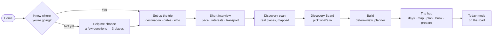
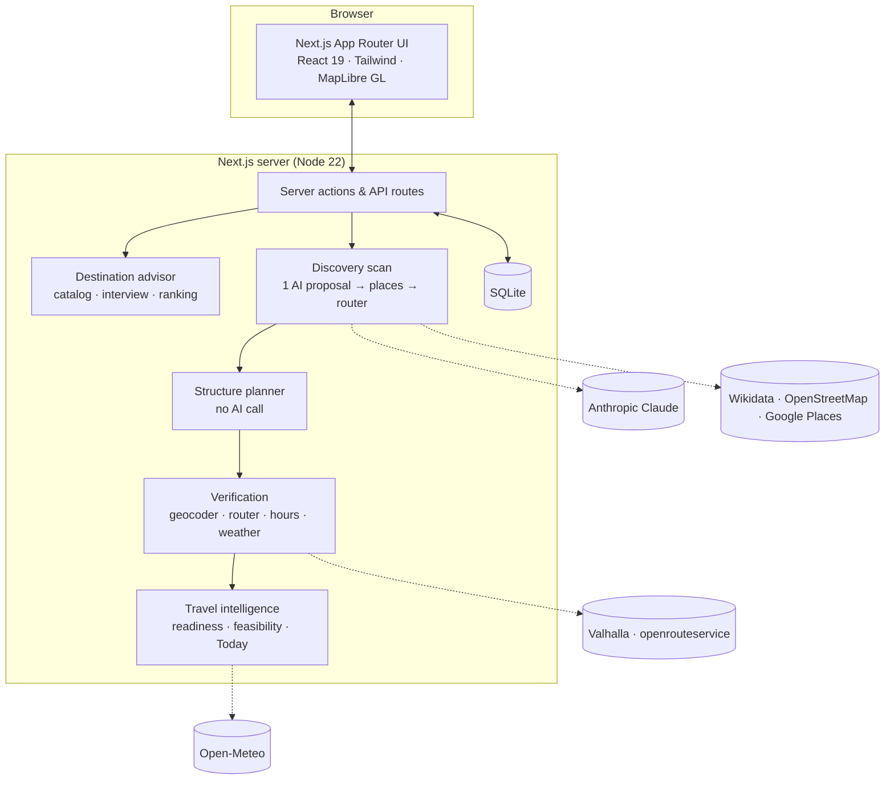

<div align="center">


# Sidequest

**Tell it how you travel. Get a trip you can actually take.**

Sidequest is a travel planner that asks the right questions once, finds the places worth going, lets you choose what's in, and then builds a realistic day-by-day trip — with real maps, real travel times, weather, food, bookings and a plan for every day you're away.

[**Open the live app →**](https://sidequestweb-production.up.railway.app) &nbsp;·&nbsp; [Help me choose where to go](https://sidequestweb-production.up.railway.app/decide) &nbsp;·&nbsp; [Run it locally](#-run-it-locally)


</div>

---

## Contents

- [Why Sidequest](#-why-sidequest)
- [The journey at a glance](#-the-journey-at-a-glance)
- [Features](#-features)
- [How to use it](#-how-to-use-it)
- [Under the hood](#-under-the-hood)
- [APIs and data sources](#-apis-and-data-sources)
- [Run it locally](#-run-it-locally)
- [Configuration](#-configuration)
- [Project structure](#-project-structure)
- [Deploying](#-deploying)
- [Privacy](#-privacy)
- [Contact](#-contact)

---

## ✦ Why Sidequest

Most trip planners rank places by popularity and leave you to fix the plan: *make it less rushed, add food, check the weather, what about that place nearby?* Sidequest is built the other way round.

| Instead of… | Sidequest… |
|---|---|
| A chat that invents an itinerary | Finds real places, lets you choose, then **plans deterministically** — the AI proposes, it never optimises |
| Popularity rankings | Ranks by **personal fit**: your interests, pace, budget, party, season and how far you'll go |
| "About 20 minutes" guesses | **Measured travel times** from routing services, and says so when a leg couldn't be measured |
| A list of attractions | Bases to sleep in, meals, rest, backups for bad weather, and a reason for everything it left out |
| A plan that ends at the PDF | A **trip hub**: Today mode, bookings, packing, calendar feed, offline copy, share link |

Two rules run through everything: **unknown is never treated as false** (missing evidence lowers confidence, it doesn't delete your plans), and **nothing is made up** — prices, opening hours and availability are only shown when a source says so.

---

## ✦ The journey at a glance



---

## ✦ Features

<details open>
<summary><b>🧭 Help me choose — a destination advisor</b></summary>

<br/>

For when you know *when* and *what for*, but not *where*.

- **Say it your way.** Type "somewhere outdoors this summer — hiking, wildlife, lakes and swimming" and Sidequest reads the season, interests, length, budget, who's going and where you're starting from. It never asks again for something you already said.
- **Only the questions that matter.** Each next question is the one most likely to change your shortlist ("If it could only be brilliant at one thing…", "Warm sea or mountain lakes?"). It stops when another answer wouldn't change much — usually two to five taps. Skip anything, or jump to results.
- **A live world map** shows the places taking the lead as you answer.
- **Three different answers, argued for.** Each pick says why it fits *you*, three highlights, best months, trip length, difficulty, costs, getting there and around, where you'd stay, the catch, and what hasn't been checked.
- **Real places only.** A catalog of 234 multi-day destinations — national parks, mountain ranges, coasts, island groups — across 24 parts of the world. Famous places get no bonus unless you ask for classics; little-known ones get none unless you ask for something unusual.
- **Weather checked** against twenty years of climate records for the places on screen.
- **Nudge it**: warmer, cheaper, less crowded, closer, more wildlife, more unusual, easier logistics, "more like this one", or "something completely different".
- **Plan this trip** turns a pick into an ordinary trip with everything you said carried over.

</details>

<details>
<summary><b>🗺 Trip setup and the interview</b></summary>

<br/>

- Type a destination the way you'd say it — "the Canadian Rockies", "Lisbon and the Azores", "rural Japan" — and Sidequest works out what kind of place it is (a city, a region, a country, several parts) and frames the map to match.
- Dates can be exact, a month, a season or flexible; Sidequest can suggest the best window from climate data.
- A short, adaptive interview: pace, interests and how often you want them, budget, food, who's travelling (including children, older travellers, diets and mobility), transport and how much driving is too much. Free-text notes are read into answers you can see and correct.
- Not in the mood? **Plan with smart defaults** and adjust later.

</details>

<details>
<summary><b>🔎 Discovery scan and the Discovery Board</b></summary>

<br/>

- One AI call proposes candidate places, bases and food areas for your trip; every one is then placed on the map by real place and geocoding services and timed by a router. If the AI is unavailable, an **open-data scan** (Wikidata and OpenStreetMap) builds the board instead — and says so.
- The board groups places into classics, hidden gems, side quests, food and rainy-day backups, each with a photo when a licensed one exists, travel time from base, duration, and why it fits.
- Tick what sounds good, set aside what doesn't, or let **auto-pick** choose a balanced mix. Filters by distance, effort, category and more; a map shows everything at once.

</details>

<details>
<summary><b>🧱 The planner</b></summary>

<br/>

- Builds the days **without an AI call**: priority from your picks and fit, geographic grouping, greedy insertion by travel minutes, your pace and daily drive limit, effort spacing, time-of-day windows, weather thresholds, lunch, backups — and a reason for every place it drops.
- Chooses bases (places to sleep) and how many nights in each, and keeps arrival and departure days light.
- Every build carries its own audit: what happened to every place, structural quality checks, and a feasibility verdict — *ready*, *ready with cautions*, or *needs a decision*.

</details>

<details>
<summary><b>📘 The trip hub</b></summary>

<br/>

Six views of one trip:

| View | What's there |
|---|---|
| **Overview** | The trip at a glance: days, stops, bases, a typical day's travel against your limit, the route map |
| **Days** | Day-by-day timeline with travel legs labelled *measured*, *estimated* or *not measured*, meals and backups |
| **Map** | The **Journey Explorer**: 2D or 3D terrain, trip / stay / day scales, and *Replay my day* |
| **Plan** | Tweak days locally — move, reorder, change durations, add your own stop, "fix this day" |
| **Book** | What to book and when; mark bookings done, import confirmations, keep facts the planner must respect |
| **Prepare** | Before-you-go checklist: entry and paperwork notes (from official sources only), money, plugs, apps, packing |

Plus **Ask Sidequest** for changes in plain words — it shows you exactly what would change before you apply, and Undo restores it exactly.

</details>

<details>
<summary><b>☀️ Today mode, packing and taking it with you</b></summary>

<br/>

- **Today**: a countdown before you leave; on the road, what's next, how long to get there, and the rest of the day.
- **Packing list** shaped by the weather, the activities and the trip's length.
- **Calendar**: a one-off `.ics` download or a revocable live feed that stays in sync.
- **Share** a read-only link — with your private details (party, notes, bookings, costs) stripped out.
- **Offline copy** and a print-ready trip packet.

</details>

<details>
<summary><b>👤 Accounts and your data</b></summary>

<br/>

- Plan without an account; sign in with Google to keep trips across devices — the trips you made before signing in come with you.
- Download everything Sidequest holds about you, delete a trip, or delete all your data, from your profile.

</details>

---

## ✦ How to use it

1. **Open Sidequest** and choose **I know where I want to go** or **Help me choose**.
2. **Help me choose:** describe the trip in a sentence (or just tap *Just ask me*), answer the few questions it asks, then compare the three places it suggests. Use the nudge buttons until one feels right and press **Plan this trip**.
3. **Set up the trip:** confirm the destination, dates and who's going.
4. **Answer the interview** — or press *Plan with smart defaults*.
5. **Scan and choose:** wait for the Discovery Board to fill (a few minutes for a big region), tick what you want or use auto-pick.
6. **Build my trip.** You'll land on the trip hub.
7. **Make it yours:** adjust days in *Plan*, mark bookings in *Book*, work through *Prepare*, ask Sidequest for changes in plain words.
8. **Take it with you:** add the calendar feed, save the offline copy, share the link — and open **Today** when you're on the road.

> **Tip:** anything Sidequest couldn't verify is labelled as such — check opening times, road status and anything you book before you rely on it.

---

## ✦ Under the hood



| Part | How it works |
|---|---|
| **AI** | Claude makes **at most one bounded call** per discovery scan (and one for the fallback composer when there's no board). No retries, no hidden "repair" calls. The planner, the advisor and Today mode make none. |
| **Planning** | A pure, deterministic structure planner — the same answers always give the same trip. |
| **Evidence** | Every travel leg is *measured*, *scheduled*, *estimated* or *unknown* — never silently zero. Missing evidence lowers confidence; only affirmative evidence corrects. |
| **Rendering** | Pages read stored rows only; nothing on screen calls an outside service while it renders. |
| **Monorepo** | `apps/web` (the product) plus shared packages: `core` (schemas, advisor, intelligence), `planner`, `geo`, `compiler`, `bench`. |

---

## ✦ APIs and data sources

| Area | Service | Used for |
|---|---|---|
| Discovery proposal | **Anthropic Claude** | One call proposing candidate places, bases and food areas for a trip |
| Places | **Google Places** (optional) · **Overture Maps** · **OpenStreetMap / Overpass** · **Wikidata** | Placing proposed places, trailheads and access points; the open-data scan when AI is unavailable |
| Geocoding | **Nominatim** (OpenStreetMap) | Turning what you typed into a place, through Sidequest's semantic checks |
| Routing | **Valhalla** · **openrouteservice** (optional: Google Routes) | Measured drive, walk and transit times between stops |
| Weather & climate | **Open-Meteo** (forecast + ERA5 archive) | Best-time windows, packing, daily weather, checking the advisor's temperatures |
| Photos | **Wikimedia Commons** via Wikidata | Licensed, credited photographs of places and destinations |
| Maps | **MapLibre GL** · **OpenFreeMap** tiles · **AWS Terrain Tiles** · **Natural Earth** | The interactive 2D/3D maps, terrain, and the advisor's world map |
| Sign-in | **Google OAuth** | Optional accounts |
| Hosting | **Railway** | App and SQLite volume |

Data © OpenStreetMap contributors, Overture Maps Foundation, Wikidata and Wikimedia Commons contributors, Open-Meteo / Copernicus ERA5, Natural Earth. Attribution is shown wherever the data is.

---

## ✦ Run it locally

**You'll need** Node 22 (see `.nvmrc`) and npm.

```bash
git clone https://github.com/yashnil/Sidequest.git
cd Sidequest
npm install
cp .env.example apps/web/.env.local     # then edit — see Configuration
npm run dev                              # http://localhost:4200
```

<details>
<summary><b>Try it with no API keys at all</b></summary>

<br/>

Sidequest can run entirely on recorded fixtures — useful for exploring the product without paying for anything. In `apps/web/.env.local`:

```bash
SIDEQUEST_COMPOSER_PROVIDER=fixture
SIDEQUEST_COMPILER_PROVIDER=fixture
SIDEQUEST_CLIMATE_PROVIDER=fixture
SIDEQUEST_AUTH_PROVIDER=fixture
```

*Help me choose* works fully offline in any mode — its catalog ships with the app.

</details>

<details>
<summary><b>Useful commands</b></summary>

<br/>

| Command | What it does |
|---|---|
| `npm run dev` | Start the app in development mode |
| `npm run build` / `npm run start` | Production build / serve it |
| `npm run doctor` | Check which services are configured, real, fixture or off |
| `npm run verify` | Typecheck, lint, unit tests and build in one go |
| `npx playwright test --project=desktop` | Browser tests (needs a build first) |

</details>

---

## ✦ Configuration

All settings live in `apps/web/.env.local`; `.env.example` documents every one. The essentials:

| Variable | Purpose |
|---|---|
| `ANTHROPIC_API_KEY` | Enables the AI discovery proposal (without it, scans use open data) |
| `SIDEQUEST_POI_PROVIDER=overpass` | Enables the open-data scan fallback |
| `SIDEQUEST_GEOCODER_PROVIDER=nominatim` | Place lookup for typed destinations |
| `SIDEQUEST_ROUTES_PROVIDER` / `OPENROUTESERVICE_API_KEY` | Measured travel times |
| `GOOGLE_MAPS_API_KEY` | Optional: Google Places identity and photos |
| `SIDEQUEST_CLIMATE_PROVIDER=openmeteo` | Climate-based timing and weather checks |
| `SIDEQUEST_IMAGERY_PROVIDER=wikimedia` | Licensed place photographs |
| `GOOGLE_OAUTH_CLIENT_ID` / `_SECRET` | Optional Google sign-in |
| `SIDEQUEST_DB_PATH` | Where the SQLite database lives |
| `SIDEQUEST_FETCH_USER_AGENT` | Identify yourself to public APIs (Nominatim and Wikimedia require it) |

Run `npm run doctor` after editing to see what's live.

---

## ✦ Project structure

```text
apps/web/                 the Next.js product
  src/app/(product)/      pages: home, decide, trips, hub views, today, profile…
  src/components/         UI: advisor, board, hub, journey explorer, maps, landing
  src/lib/                server logic: scan, planning, providers, intelligence, db
packages/core/            shared schemas, destination advisor, travel intelligence
packages/planner/         planning primitives
packages/geo/             geometry and distance utilities
packages/compiler/        optional deep region compiler
e2e/                      Playwright browser tests
docs/                     design system, research and pass reports
```

---

## ✦ Deploying

Sidequest runs as one Railway service with a SQLite volume; `railway.json` holds the build and health-check settings, and **a push to `main` deploys automatically**. Production needs a few required settings (base URL, session secret, database path) — the server refuses to start without them, so a bad deploy never replaces a good one. Health: `GET /api/health`; readiness of every service: `GET /api/readiness`.

---

## ✦ Privacy

Sidequest stores only what it needs to plan your trip. Shared links and calendar feeds never include your party details, notes, booking references or costs. You can download or delete your data at any time from your profile. See the in-app [Privacy](https://sidequestweb-production.up.railway.app/privacy) and [Terms](https://sidequestweb-production.up.railway.app/terms) pages.

---

## ✦ Contact

- **Questions, bugs or ideas:** [open an issue](https://github.com/yashnil/Sidequest/issues)
- **In the app:** [Help & contact](https://sidequestweb-production.up.railway.app/support)
- **Maintainer:** [@yashnil](https://github.com/yashnil)

<div align="center">
<br/>
<sub>Plans are drawn from published sources and frozen on the day they're built. Check opening times, road status and anything you book before you rely on it.</sub>
</div>
